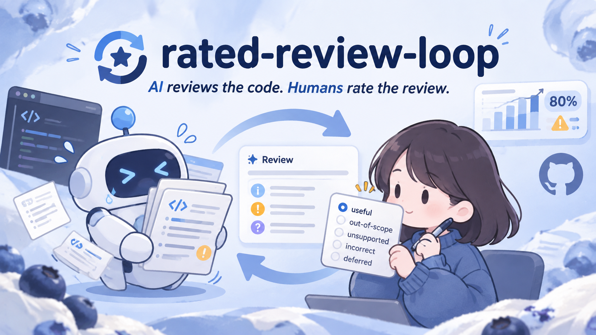

<p align="center">
  
</p>

# rated-review-loop

English | [한국어](./README-ko_kr.md)

Review AI-written code in a loop, let the owner rate every finding, and get alerted when the review stops being useful.

Coding agents such as Claude Code and Codex can review the code they write, but two things usually go unchecked: whether the review actually happens every time, and whether its findings are worth reading. `rated-review-loop` makes the review a step the agent cannot skip after its checks pass, records how the person responsible rated each finding, and measures the useful rate per review skill version and reviewer. When the most recent ratings fall below a threshold, it says so on the pull request.

## Why

- **Reviews get skipped.** An agent asked to "review your changes" does it sometimes. A hook that runs after every implementation does it every time.
- **Unrated reviews cannot improve.** Without ratings, editing the review instructions is guesswork. With ratings grouped by skill version, you can compare the new skill to the old one.
- **Usefulness drifts.** A model update or a skill edit can quietly make reviews noisy. A rolling window of the last 100 ratings catches that early, and a full window is required before alerting so small samples do not cause false alarms.

## How it works

```text
begin ──► implement ──► ready ──► [Stop hook] checks ──► review ──► submit ──► owner rates ──► stats
 baseline                          all must pass        session agent        ledger (committed)
                                                        or claude/codex CLI
```

1. **begin** records a content id (git blob id) for every file in scope, so edits that existed before the task are not attributed to the agent. Unchanged tracked files are not read; only uncommitted files are copied locally.
2. **ready** lists the files the agent implemented.
3. When the agent stops, the **Stop hook** runs your checks. Only if all pass does it ask for a review: either the same session reviews (`session`), or a separate `claude` / `codex` CLI process reviews independently (`claude-cli`, `codex-cli`).
4. The review is a JSON report validated against the change: every finding needs a file and line inside the change, evidence, impact and a minimal fix.
5. The agent ends its reply with a rating question. The owner answers, and the rating is stored in the **ledger**, one small JSON file per run, committed and shared by the team. Reviewed source stays local.
6. **stats** groups ratings by skill version and reviewer and checks the latest window.

## Install

```sh
pnpm add -D rated-review-loop
```

Requires Node.js 22 or later and git. For CLI reviewers, install and log in to the `claude` or `codex` CLI.

## Setup

### 1. Hooks

```sh
cp node_modules/rated-review-loop/examples/claude-settings.json .claude/settings.json
cp node_modules/rated-review-loop/examples/codex-hooks.json .codex/hooks.json
```

Merge them into existing files if you already have hooks. The `--client` argument tells the loop which agent is reviewing; it is recorded with every rating.

### 2. Config

Create `rated-review-loop.config.json` in the repository root. Every key is optional.

```json
{
  "skill": "node_modules/rated-review-loop/skills/review-completed-code/SKILL.md",
  "guidelines": ["AGENTS.md", "docs/architecture.md"],
  "checks": ["pnpm typecheck", "pnpm lint"],
  "include": ["src/**/*.{ts,tsx}", "scripts/**/*.{js,mjs,ts}"],
  "reviewer": { "mode": "session" },
  "language": "en",
  "stats": { "groupBy": ["skill", "reviewer"], "window": 100, "threshold": 0.8 }
}
```

### 3. Ignore local state

```gitignore
.rated-review-loop/local/
```

Commit `.rated-review-loop/ledger/`. It contains finding titles, rules and ratings, never source code. Local runs that finished more than 14 days ago are deleted on the next `begin`, or on demand with `prune`.

### 4. Review health on pull requests

```sh
cp node_modules/rated-review-loop/examples/review-health.yml .github/workflows/review-health.yml
```

The workflow comments only when a group is at or below the threshold, keeps a single comment up to date, and deletes it after recovery. It reads the committed ledger, so it needs no model access or API key.

## Reviewers

| Mode | Who reviews | Model recorded |
| --- | --- | --- |
| `session` | The agent that wrote the code, in the same session | From the session transcript |
| `claude-cli` | `claude -p` with read-only tools and a JSON schema | Reported by Claude Code |
| `codex-cli` | `codex exec --sandbox read-only` with an output schema | From the Codex session log |

All modes produce the same report shape, so ratings and statistics do not depend on the reviewer. CLI reviewers use the logins of the installed CLIs; no API key is stored by this tool.

## Rating findings

| Label | Meaning |
| --- | --- |
| `useful` | Valid and worth acting on |
| `out-of-scope` | Valid, but not for this change |
| `unsupported` | Taste or weak evidence |
| `incorrect` | Factually wrong |
| `deferred` | Undecided; not counted as a decision |

Ratings can be changed later. History is kept, and statistics use the latest rating.

## Statistics and alerts

```sh
npx rated-review-loop stats --format text
```

```text
skill 306f61d5d9f6 · reviewer claude: 41 runs, 63 findings, 4 unrated — useful 86% over the last 100
skill 9b1e04c2aa10 · reviewer codex: 12 runs, 18 findings, 2 unrated — useful 81% over 16/100 (not enough ratings to alert)
```

- **Skill version** is a hash of the skill file content only. Upgrading this tool does not reset statistics, and reverting the skill continues its earlier record.
- **Window**: the latest `window` decided ratings of a group. A group alerts only when the window is full and its useful rate is at or below `threshold`.
- **Grouping**: `["skill", "reviewer"]` by default. Add `"model"` to separate model versions once your team rates enough findings to fill a window per model.

## Configuration reference

| Key | Default | Description |
| --- | --- | --- |
| `skill` | bundled skill | Review instructions; their hash is the skill version |
| `guidelines` | `[]` | Project documents the reviewer compares against |
| `checks` | `[]` | Shell commands that must all pass before review |
| `checkTimeoutMs` | `120000` | Timeout per check |
| `include` / `exclude` | all files / dependencies, builds, lockfiles | Globs of reviewable files; binary and files over 2 MB are skipped |
| `reviewer.mode` | `session` | `session`, `claude-cli` or `codex-cli` |
| `reviewer.model` | client default | Model for CLI reviewers |
| `language` | `en` | Language of findings |
| `stats.groupBy` | `["skill", "reviewer"]` | Any of `skill`, `reviewer`, `model` |
| `stats.window` | `100` | Size of the rolling window |
| `stats.threshold` | `0.8` | Alert at or below this useful rate |
| `ledgerDir` / `localDir` | `.rated-review-loop/ledger` / `.rated-review-loop/local` | Committed and local storage |

## CLI reference

```text
rated-review-loop hook --client <claude|codex>          Handle a SessionStart/Stop hook event from stdin
rated-review-loop begin <session-key> <task>            Record the baseline before implementing
rated-review-loop ready <session-key> <file...>         Mark the files you implemented as ready for checks
rated-review-loop packet <run-id>                       Print the change under review
rated-review-loop submit <run-id> <report.json>         Record a review report written by the session agent
rated-review-loop review <run-id>                       Have the configured CLI reviewer review and record the run
rated-review-loop rate <run-id> <F#> <label> [note]     Record the owner's rating of a finding
rated-review-loop status <session-key>                  Show the run bound to a session
rated-review-loop cancel <session-key>                  Cancel the run bound to a session
rated-review-loop stats [--format json|text|markdown]   Usefulness per skill version and reviewer
rated-review-loop prune [--days <n>]                    Delete local runs finished more than n days ago (default 14)
```

## Limitations

- The loop measures whether findings were useful, not what the review missed. A run with no findings is not proof of correctness.
- Ratings are only as good as the owner's answers; ambiguous answers should stay unrated.
- Pull requests from forks get a read-only token, so the health comment cannot be posted there.

## Contributing

Run `pnpm typecheck`, `pnpm lint`, `pnpm test` and `pnpm check:readme-sync` before opening a pull request. Keep `README.md` and `README-ko_kr.md` in step: CI compares their heading structure and code blocks, and a pull request that changes only one of them needs a line `README one-sided: <reason>` in its description.

## License

MIT
