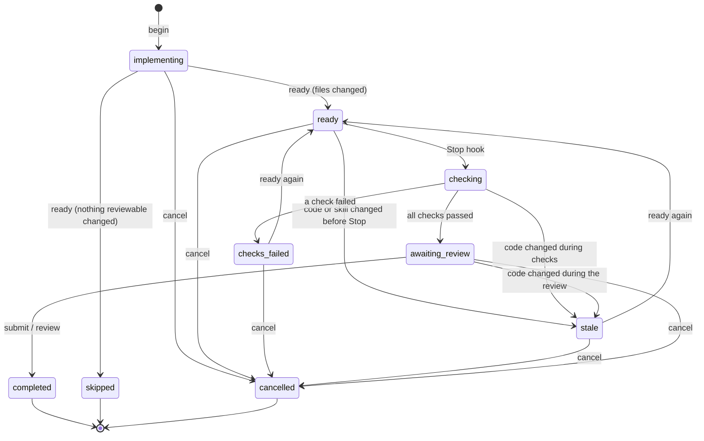

# Design

This document explains how rated-review-loop works and why it is built this way: the run lifecycle, the decisions
behind it, what changed when it was extracted from the app it grew in, the extension points planned next, and what
it does not measure. For setup and commands, see the [README](../README.md).

## Problem

Coding agents can review their own changes, but in practice two things go unchecked:

1. **Whether the review happens.** "Review your changes" in a prompt is followed sometimes. A hook that runs after
   every implementation runs every time.
2. **Whether the review is worth reading.** Without the owner's judgment of each finding, changing the review
   instructions is guesswork, and a model update that makes reviews noisy goes unnoticed.

The loop answers both by making review a step that follows passing checks, asking the owner to rate every finding,
and measuring the useful rate per review-skill version and reviewer.

## Roles

| Role | Does | Never does |
| --- | --- | --- |
| Hooks (`SessionStart`, `Stop`) | Inject instructions, run checks, request the review, check that the rating question was asked | Edit code, rate findings |
| Coding agent | Runs `begin` and `ready`, implements, reviews (session mode) or runs `review` (CLI mode), reports, records ratings with `rate` | Rate on the owner's behalf |
| CLI reviewer (`claude -p`, `codex exec`) | Reads the packet and writes a JSON report, read-only | Edit files |
| Owner | Rates each finding | |
| CI | Computes usefulness from the committed ledger and comments on pull requests | |

## Run lifecycle

A run is one review cycle for one task in one session.



Mermaid state names cannot contain hyphens; the phases are `checks-failed` and `awaiting-review`.

The run is stored as a discriminated union on `phase` (`src/schemas.ts`), so each phase carries exactly the data that
exists at that point: an `implementing` run has a baseline but no files, an `awaiting-review` run has the change but
no findings, and a `completed` run always has a reviewer. Moving between phases builds a new object from the shared
base, so no field carries over by accident.

After `completed`, the Stop hook checks that the agent's final message contains the rating question. It reminds once
(`reminded`), then records `missed` and stops blocking. It never waits for the owner's answer.

## Key decisions

### Review only after every check passes

A review of code that does not type-check or lint is spent on what tools already catch. Checks are the gate; the
review looks only at what checks cannot judge (state and data coupling, missing branches, split between decisions
and I/O, abstractions that add coupling). A failed or interrupted check is never retried automatically, so the hook
cannot loop.

### The baseline is taken at `begin`, not from git HEAD

Owners often have uncommitted edits when they ask an agent for work. A diff against HEAD would attribute those edits
to the agent. `begin` records the state of every file in scope, and only files that differ from that state, and that
the agent lists in `ready`, are reviewed.

### Snapshots store git blob ids, not file contents

The first version stored the full text of every file in scope in each run. Every Stop hook read the whole scope
twice, and each run file was as large as the repository's text. Now:

- Clean tracked files take their blob id from the index (`git ls-files -s`) and are never read.
- Only files `git status` reports as modified or untracked are hashed, with `git hash-object`, which applies the same
  filters as the index, so a file edited and then restored compares equal.
- Files that were dirty at `begin` are copied into the local object store, because that state exists nowhere in git.
  Other "before" content is read back with `git cat-file --filters`.
- `prune` deletes finished runs older than 14 days and objects no run references.

On app-front-end (866 files in scope) the stored baseline per run went from 4.8 MB to 74 KB.

### Only the owner rates, and ambiguity stays unrated

The value of the statistics depends on ratings being real judgments. The agent records only what the owner said;
"I won't apply it" does not make a finding incorrect; an ambiguous answer is left unrated. Five labels separate
reasons a finding was not useful (`out-of-scope`, `unsupported`, `incorrect`) from undecided (`deferred`).
`deferred` is excluded from the denominator because it is not a decision.

### The skill version is the hash of the skill alone

Statistics are grouped by skill version. The version is the content hash of the review skill, not of the tool, so
upgrading rated-review-loop does not split the statistics, and reverting the skill resumes the old group.
The original implementation hashed the tool's scripts too, which mixed tool changes into skill comparisons.

Guidelines and future project instructions also affect the review but are not part of the hash yet; see
[Extension points](#extension-points).

### Ratings are committed; reviewed source stays local

| Store | Contents | Committed |
| --- | --- | --- |
| Ledger (`.rated-review-loop/ledger/<run-id>.json`) | Task, skill version, reviewer and model, finding locations, titles and rules, ratings | Yes |
| Local (`.rated-review-loop/local/`) | Runs with the reviewed source, check output, copies of uncommitted files, review reports | No |

Committing the ledger lets a team pool ratings and lets CI compute usefulness on every pull request. One file per run
means concurrent pull requests rarely conflict. The ledger never contains source code.

### Alerts need a full window

The health check looks at the most recent decided ratings (default 100) and alerts at or below a threshold
(default 80% useful). It alerts only when the window is full, so a handful of early ratings cannot raise an alarm.

### Hooks must never trap the conversation

- A broken hook reports one `systemMessage` and lets the turn end.
- A run's review is requested once. A Stop hook started inside another hook's continuation (`stop_hook_active`)
  defers to the next turn.
- Duplicate hook registrations are serialized with a lock directory, so checks run once.

### Session or CLI reviewer

| Mode | Reviewer | Trade-off |
| --- | --- | --- |
| `session` | The agent that wrote the code | Fast and free, but it knows why it wrote the code and may be lenient |
| `claude-cli`, `codex-cli` | A separate read-only process with a fresh context | Independent and can use another model, but slower and costs more |

The ledger records the reviewer and model, so the modes can be compared on the same project.

### Validate inputs, type outputs

Everything that comes from outside (hook events, review reports, run files, ledger entries, transcripts) is parsed
with zod, so a malformed file fails with a message instead of a wrong state. What the CLI prints is produced here and
read by agents, so it is typed with TypeScript interfaces (`PhaseResult`, `Packet`, `RunStatus`, `RateResult`) and
pinned by tests, without runtime parsing.

### CLI only

The package has no importable API. Its public contract is the commands, the config file and the ledger format.
Keeping that surface small lets 0.x change internals, such as the snapshot format, without breaking users.

## Changes from the app implementation

The loop ran for six weeks in a React Native app before it was extracted (results in the README). Extraction kept
the review rules and changed the following.

| Area | In the app | In the package | Why |
| --- | --- | --- | --- |
| Checks, scope, guidelines | Hard-coded (tsc, lint, architecture, naming; `src/`, `scripts/`) | Config (`checks`, `include`, `exclude`, `guidelines`) | Other projects have other checks and layouts |
| Version hash | Skill + tool scripts | Skill only | Tool upgrades should not split statistics |
| Rating storage | Local, ignored by git | Committed ledger | Teams pool ratings; CI can alert |
| Snapshots | Full file contents | Git blob ids | Size and speed on large repositories |
| Reviewer | The session agent | Session or a separate CLI | Reduce self-review bias; compare reviewers |
| Metrics | Useful, incorrect and low-value rates; check retries; review duration | Useful rate over a rolling window, label counts | Kept the one number that drives an alert; the others may return |
| `checks-only` comparison mode | Available | Removed | Comparing with and without review needs matched tasks, which the loop cannot ensure |
| Learning-record gate at `begin`, scenario map after review | Built in | Removed | App-specific workflow; to return as generic extension points |
| Skeleton files | Excluded in code | Excluded by config (`**/*.skeleton.*`) and mentioned in the skill | Naming convention of one project |
| Language | Korean instructions and question | English instructions, findings in `language` | Shared package; the question is not localized yet |

## Extension points

The app's learning-record gate and scenario map were removed because they were hard-coded to one workflow. What they
did is generic: make the agent read the right documents, and require a step before work starts. These are planned
as configuration, to be built while the package is trialled in the app and fixed before the config format is
published.

### Conditional guidelines

```json
"guidelines": [
  "AGENTS.md",
  {
    "path": "docs/architecture/04-dependency-boundaries.md",
    "when": "an import crosses a src/features/* boundary",
    "covers": "allowed dependency directions between features"
  }
]
```

- A string is always read; an object is read when `when` applies.
- `when` describes the change, not the author's situation, because the reviewer sees a diff. One sentence, length-limited.
- `path` must exist when the config is loaded; duplicate paths and unknown fields are rejected.
- `covers` names the rules the document holds, so findings can cite it as `rule`.

The config moves from hand-written validation to a zod schema, which also generates a JSON Schema so editors and
agents can complete and check `rated-review-loop.config.json`.

### Gates before `begin`

```json
"gates": { "begin": ["pnpm check:learning --design-only \"$RATED_REVIEW_LOOP_INPUT\""] }
```

Commands that must pass before `begin` records a baseline. A failure refuses `begin` and shows the command output to
the agent. `begin <key> <task> --input <value>` passes extra input as an environment variable. Checks gate the
review after implementation; gates do the same before it starts.

### Project instructions

```json
"instructions": {
  "session": "Before implementing, write the design discussion in docs/learning/... and pass it with --input.",
  "review": "After submitting, write three scenarios that could break in the learning record's scenario map."
}
```

`session` is appended to the SessionStart context, `review` to the review request.

### Versioning the review inputs

Anything that changes what the reviewer is told should change the version used for statistics. The version will
hash the skill, `instructions.review` and the guideline list together. Gates and session instructions do not affect
the review itself and stay out of the hash.

## What the loop does not measure

- **Recall.** A run with no findings is not evidence that nothing was missed. Measuring recall needs an offline set
  of changes with known defects, run against each skill version.
- **Statistical confidence.** The alert compares a rate with a threshold. Comparing two skill versions needs
  confidence intervals and a minimum sample, which `stats` does not compute yet.
- **Confounders.** Usefulness also depends on the model, the guidelines and the kind of task. The ledger records the
  model; guidelines and task type are not recorded.
- **Rater bias.** When the author rates their own agent's findings, ratings may be lenient. A team ledger with
  several raters reduces this but does not remove it.
- **Agent compliance.** `begin` and `ready` are run by the agent following instructions. If the agent skips `begin`,
  no review happens. Starting runs automatically from a `UserPromptSubmit` hook is possible now that snapshots are
  cheap, and will be decided from how often this happens in the app trial.
